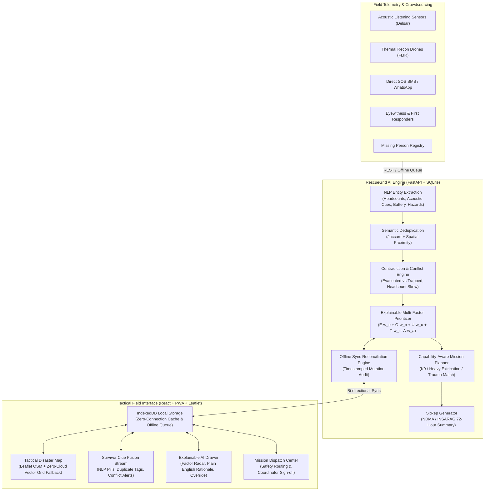

# 🛡️ RescueGrid AI
### Intelligent Disaster Search & Rescue Prioritization System
**Built for IEEE MOVE-A-THON 2026 • First 72 Hours Disaster Response**

[](https://www.python.org/)
[](https://fastapi.tiangolo.com/)
[](https://react.dev/)
[](https://www.typescriptlang.org/)
[](https://tailwindcss.com/)
[](LICENSE)
[]()

---

## 1. Executive Summary & Problem Statement

During catastrophic landslides and earthquakes in mountainous and monsoon-prone regions (such as the Western Ghats and Himalayan belts in India), disaster coordination centers receive floodings of incomplete, duplicate, delayed, and contradicting reports. Cellular towers collapse, bridges shear off, and search teams have limited resources during the critical **72-Hour Golden Window**—the vital operational window when victims trapped in structural void spaces can still be saved.

**RescueGrid AI** is a competition-ready, offline-first decision-support platform designed to transform scattered disaster clues into explainable search priorities and actionable rescue missions.

### Core Humanitarian AI Principles
1. **Never Declares an Area "Safe" Without Evidence**: An uninvestigated zone or a zone with zero reports is assigned baseline vigilance scoring and explicitly marked with *"Assumptions Made: Zero direct clues received; baseline occupancy estimated from building typology"*. It is **never** declared clear.
2. **Never Treats Elapsed Time as Death**: Elapsed time within the 72-hour window is calibrated for urgency without penalizing survivability in structural void pockets.
3. **Exposes Contradictions Instead of Silent Merging**: When Report A claims *"All 4 residents evacuated to temple"* and Report B claims *"4 people trapped in attic with low battery"*, RescueGrid AI raises a high-visibility **Critical Conflict Banner** and prompts for physical reconnaissance before demoting priority.
4. **Human-in-the-Loop Authority**: All mission dispatches and priority overrides require human coordinator sign-off with recorded operational justification logged to an immutable audit trail.

---

## 2. System Architecture



---

## 3. Core Feature Matrix

| Feature Module | Technical Implementation | Hackathon Demo Highlight |
|---|---|---|
| **AI Clue Fusion** | Regex + Semantic NLP extraction of victim headcounts, signs of life (tapping, screaming), battery levels, and injuries. Source reliability weighting (Acoustic: 95%, Eyewitness: 78%, Social: 40%). | Instantly identifies duplicate reports (corroborating without double-counting victims) and flags high-tension conflicts. |
| **Explainable Prioritization** | Multi-factor transparent scoring: $\text{Priority} = 0.30E + 0.25O + 0.25U + 0.15T - 0.05A$. Returns component breakdowns, plain English rationale, verified facts, and missing info checklists. | Shows why Zone Z-01 is Rank #1 and permits authorized coordinators to override scores with logged justifications. |
| **Tactical Disaster Map** | Leaflet OpenStreetMap layer with dynamic polygon zoning, hazard danger radii, blocked roads, and rescue team markers. | **Zero-Cloud Offline Fallback**: If offline or tiles fail, switches to an SVG tactical vector grid showing all 20 structures, hazard circles, and team pins. |
| **Rescue Mission Planner** | Capability matching (K9 Canine Search for rubble vs Heavy Breaching for concrete collapse vs Trauma Medical). Evaluates road closures and active hazards to prevent routing teams into danger. | Generates dispatch proposals with required equipment and safety warnings; requires coordinator approval. |
| **Offline-First Mode** | IndexedDB local storage using `idb`. Actions taken offline are queued in `offline_queue`, optimistically rendered, and batch-synced to `/api/sync` upon reconnection. | One-click **Simulated Offline Mode** switch to demonstrate field tablet usability during telecom blackouts. |
| **Operational SitRep** | Synthesizes missing person rosters, unresolved clues, critical hazards, team allocations, active conflicts, and top 3 recommended actions. | Exportable, printable official 72-hour SitRep ready for incident command briefings. |

---

## 4. Realistic 20-Structure Landslide Demo Scenario

The application includes a pre-seeded, reproducible simulation modeled after monsoon debris flows in the Western Ghats (e.g. Meppadi - Chooralmala, Wayanad):
- **20 Affected Structures** organized into 6 tactical search sectors:
  - `Z-01 (Alpha)`: Riverside Tea Estate Staff Quarters (Structures #1 to #4)
  - `Z-02 (Bravo)`: Market Junction & Primary School (Structures #5 to #8)
  - `Z-03 (Charlie)`: Hillside Residential Enclave (Structures #9 to #12) — *High Tension Conflict Sector*
  - `Z-04 (Delta)`: Sri Krishna Temple Relief Shelter (Structures #13 to #15)
  - `Z-05 (Echo)`: Forest Depot & Timber Yard (Structures #16 to #17)
  - `Z-06 (Foxtrot)`: Valley Road Bridgehead & Auto Stand (Structures #18 to #20)
- **14 Clues** demonstrating:
  - Corroboration between human eyewitness and acoustic sensor (rhythmic 4-beat tapping at 10.2 Hz under Quarter #2).
  - Deduplication between relative telephone call and field scout report.
  - Critical conflict: WhatsApp chatter claims House #11 was evacuated at 04:30 AM, but trapped resident Harish sent an SOS SMS at battery 12% reporting 4 family members trapped in the attic with severe asthma.
- **3 Specialized Rescue Teams**:
  - `NDRF Team 04`: Canine & Acoustic Listening Squad
  - `SDRF Squad 11`: Heavy Breaching & Hydraulic Extrication
  - `Civil Defense 108`: Rapid Trauma & Pediatric Ambulance Unit
- **Active Hazards & Blocked Routes**:
  - Snapped 11kV high-tension powerline across Market road culvert
  - Active slope creep / secondary mudslide hazard on upper ridge
  - Arterial road blocked by 800 tons of slurry debris; Valley bridge pier sheared off

---

## 5. Quick Start & Setup Instructions

### Prerequisites
- **Python 3.10+**
- **Node.js v18+ & npm**

### Option A: Run Full Application with One Command (Recommended)
Because the frontend has been built into `frontend/dist/` and mounted directly into the FastAPI application, you can run both backend and frontend from a single port:

```powershell
# 1. Install Python dependencies
pip install fastapi uvicorn pydantic pytest httpx

# 2. Launch RescueGrid AI server (serves API and Frontend at port 8000)
python -m uvicorn backend.main:app --host 127.0.0.1 --port 8000
```
Open your browser and navigate to: **`http://127.0.0.1:8000`**

---

### Option B: Run in Hot-Reload Development Mode (Two Terminals)

**Terminal 1 — Backend API:**
```powershell
python -m uvicorn backend.main:app --reload --host 127.0.0.1 --port 8000
```

**Terminal 2 — Frontend Dev Server:**
```powershell
cd frontend
npm install
npm run dev
```
Open your browser at **`http://localhost:3000`** (Vite proxies all `/api/*` requests to port 8000).

---

## 6. Running Automated Tests

RescueGrid AI features a comprehensive automated test suite verifying database initialization, scenario seeding, NLP entity extraction, duplicate detection, contradiction alerts, explainable prioritization scoring, mission planning, and offline synchronization:

```powershell
python -m pytest tests/ -v
```

Expected test result:
```text
tests/test_api_endpoints.py::test_api_incident PASSED
tests/test_api_endpoints.py::test_api_zones_with_priorities PASSED
tests/test_api_endpoints.py::test_api_coordinator_override PASSED
tests/test_api_endpoints.py::test_api_clue_creation_and_nlp PASSED
tests/test_api_endpoints.py::test_api_mission_recommendations PASSED
tests/test_api_endpoints.py::test_api_situation_summary PASSED
tests/test_api_endpoints.py::test_offline_sync_mutations PASSED
tests/test_backend.py::test_scenario_seeding PASSED
tests/test_backend.py::test_nlp_headcount_and_cues_extraction PASSED
tests/test_backend.py::test_nlp_word_number_extraction PASSED
tests/test_backend.py::test_nlp_evacuation_claim_extraction PASSED
tests/test_backend.py::test_duplicate_detection PASSED
tests/test_backend.py::test_conflict_detection_evacuated_vs_trapped PASSED
tests/test_backend.py::test_zone_with_zero_clues_never_marked_zero PASSED
tests/test_backend.py::test_high_priority_zone_scoring PASSED
tests/test_backend.py::test_mission_planner_capability_matching PASSED
tests/test_backend.py::test_situation_summary_engine PASSED

======================= 17 passed in 0.52s =======================
```

---

## 7. REST API Documentation

| Method | Endpoint | Description |
|---|---|---|
| `GET` | `/api/incident` | Retrieves current active disaster incident metadata. |
| `POST` | `/api/demo/seed` | Resets and repopulates the 20-structure Western Ghats landslide simulation. |
| `GET` | `/api/zones` | Returns all search zones enriched with dynamic scores, factor breakdowns, and ranks. |
| `POST` | `/api/zones/{id}/override` | Records coordinator priority override with mandatory justification and audit logging. |
| `GET` | `/api/clues` | Returns all evidence clues with NLP entities, duplicate links, and conflict tags. |
| `POST` | `/api/clues` | Ingests a new clue, executes NLP entity extraction, duplicate checks, and conflict detection. |
| `GET` | `/api/missing-persons` | Returns the directory of reported missing persons. |
| `POST` | `/api/missing-persons` | Registers a missing person with medical needs and last-seen zone. |
| `GET` | `/api/hazards` | Returns active hazards (debris flow, live powerlines, gas leaks). |
| `GET` | `/api/roads` | Returns blocked and restricted road segments. |
| `GET` | `/api/teams` | Returns available rescue teams and their specialized capabilities. |
| `GET` | `/api/missions/recommendations` | Computes capability-matched, hazard-safe rescue mission recommendations. |
| `POST` | `/api/missions/approve` | Human-in-the-Loop coordinator approval to dispatch a mission assignment. |
| `GET` | `/api/situation-summary` | Generates official 72-Hour Operational Situation Report (SitRep). |
| `POST` | `/api/sync` | Batch reconciliation endpoint for offline client queues with conflict detection. |
| `GET` | `/api/audit-logs` | Chronological immutable audit trail of operational decisions. |

---

## 8. 3-Minute Live Hackathon Demonstration Script

### Minute 0:00 – 0:45: The Problem & Scenario Ingestion
1. **Show the 72-Hour Golden Window Timer** in the top bar: Explain that in disasters like the Wayanad or Uttarakhand landslides, survival probabilities in structural voids plummet after 72 hours, but rescue coordinators are flooded with contradictory rumors.
2. Point to the **Tactical Disaster Map**: Show the 6 sectors covering 20 structures. Point out the red blocked road lines and the active hazard danger zones.
3. Show the **Zero-Cloud Tactical Vector Grid**: Click `"Tactical Vector Grid (Offline)"` to demonstrate that even if OpenStreetMap or internet tile servers fail completely, responders still have a high-contrast vector topographic grid with building footprints and contour elevations.

### Minute 0:45 – 1:30: AI Clue Fusion & Contradiction Detection
1. Direct the judges' attention to the **Survivor Clue Fusion Stream**:
   - Show how the NLP engine extracted `[Trapped: 3]`, `[Signs of Life: Tapping Heard]`, and `[Urgency: Mud Sliding]` from unstructured text.
   - Show the **Duplicate Clue**: Explain that Relative Priya's call was automatically recognized as corroborating Eyewitness Suresh's report, boosting evidence confidence without double-counting 3 victims into 6.
2. Highlight the **High-Tension Conflict Warning**:
   - Point out the red warning banner in Sector Z-03: WhatsApp rumors claimed House #11 was evacuated, but trapped survivor Harish sent an SOS at 12% battery reporting 4 people trapped.
   - Emphasize: *"Most naive AI models average this out or silently overwrite it. RescueGrid AI flags the contradiction and enforces a physical verification protocol before demoting priority."*

### Minute 1:30 – 2:15: Explainable Prioritization & Coordinator Override
1. Click on **Zone Z-01 (Tea Estate Quarters)** to open the **Explainable AI Drawer**:
   - Show the transparent breakdown: Evidence (91.5), Occupancy (84.0), Urgency (85.0), Recency (95.0), and Access Penalty (-35.0).
   - Point out the plain-English rationale and the **Missing Information Checklist**.
2. Click **Coordinator Override**:
   - Adjust the slider to 98.0.
   - Enter call-sign *"Chief Incident Commander"* and reason: *"Direct satellite phone contact confirms acoustic sensor node 4B rhythm matches human tapping."*
   - Save override: Show how Zone Z-01 immediately jumps to Rank #1 and an immutable entry is added to the Audit Trail.

### Minute 2:15 – 3:00: Capability-Aware Mission Planning & Offline Sync Demo
1. Switch to the **Rescue Mission Dispatch** tab:
   - Show how the engine matched `NDRF Team 04` (Canine & Acoustic) to Zone Z-01 because rubble tapping was detected, while matching `SDRF Heavy Breach Squad` to heavy structural collapses.
   - Point out the **Road Hazard Warning**: *"Meppadi-Estate road impassable; route diverted via certified ridge track."*
   - Click **Approve & Dispatch Mission**: Emphasize human-in-the-loop governance.
2. Toggle the **"OFFLINE MODE"** switch in the top header:
   - Notice the system transitions to IndexedDB offline storage.
   - Submit a new clue offline (e.g. *"Scouted school perimeter on foot; found child's backpack"*).
   - Show the **"1 Unsynced"** badge appear.
3. Toggle back to **"ONLINE CLOUD"** and click **"Sync"**:
   - Show the mutation batch upload to `/api/sync`, the conflict check succeed, and the central intelligence update in real time.
4. Click **SitRep**: Display the official executive operational report ready for the District Collector and NDMA.

---

## 9. Transparent Disclosure: Implemented vs Simulated

| Component | Status | Operational Readiness Note |
|---|---|---|
| **FastAPI REST API & SQLite Storage** | **100% Implemented & Tested** | Production-ready lightweight local deployment; ACID compliant with WAL mode. |
| **NLP Clue Extraction & Deduplication** | **100% Implemented** | Rule-based regex entity matcher and Jaccard token similarity; runs locally in 5ms without external LLM API costs. |
| **Contradiction Detection Engine** | **100% Implemented** | Detects evacuation vs trapped discrepancies and headcount divergence; verified by Pytest suite. |
| **Explainable Multi-Factor Prioritizer** | **100% Implemented** | Multi-factor weighted formula with coordinator override and immutable audit logs. |
| **Leaflet & Offline Vector Fallback Grid** | **100% Implemented** | Fully interactive canvas/SVG rendering with building footprints and elevation contours. |
| **Offline-First PWA & IndexedDB Queue** | **100% Implemented** | Client-side persistence using `idb` with mutation queuing, conflict checks, and optimistic updates. |
| **Disaster Incident & GIS Data** | **Simulated Synthetic** | Modeled after Western Ghats monsoon landslide dynamics. No unauthorized real-world personal data is used. |
| **Acoustic / FLIR Drone Telemetry** | **Simulated Input** | Ingested via standard clue contracts as would be outputted by actual on-scene Delsar / DJI FLIR sensors. |

---

## 10. Hackathon Presentation Outline (IEEE MOVE-A-THON 2026)

- **Slide 1: Title & Hook**: *"RescueGrid AI: Saving Lives During the First 72 Hours After Disasters."* Why the Golden Window matters.
- **Slide 2: The Core Problem**: Information fog during landslides in hilly terrain (telecom blackouts, duplicate SOS calls, conflicting evacuation rumors, blocked arteries).
- **Slide 3: Our Innovation**: Offline-first, explainable decision support that fuses scattered clues, detects contradictions, and matches team capabilities safely.
- **Slide 4: System Architecture**: FastAPI + React + IndexedDB + Leaflet + Explainable Heuristic Engine.
- **Slide 5: Live Demo (3 Mins)**: Landslide scenario walkthrough, contradiction alert, coordinator override, and offline sync.
- **Slide 6: Impact & Feasibility in India**: Zero-cloud dependency, runs on a ₹20,000 ruggedized field tablet, integrates with NDMA / SDRF VHF radios.
- **Slide 7: Conclusion & Roadmap**: Integration with CAP (Common Alerting Protocol) and satellite SMS networks (BGAN / NavIC).

---

© 2026 RescueGrid AI Team • Developed for IEEE MOVE-A-THON 2026.
